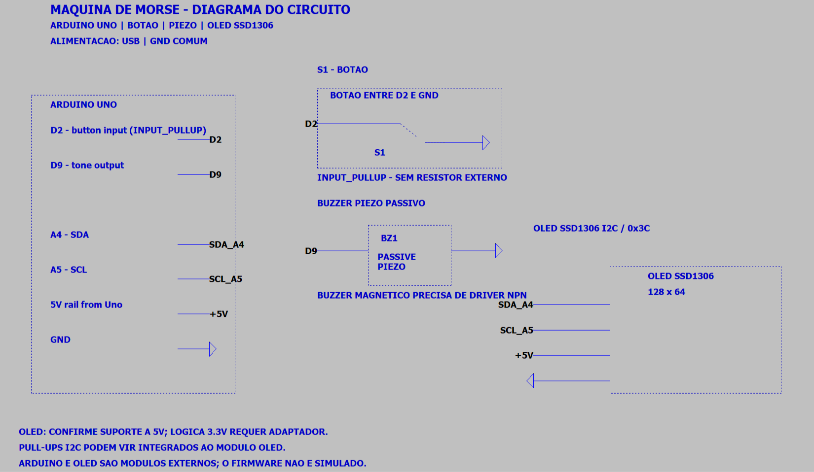
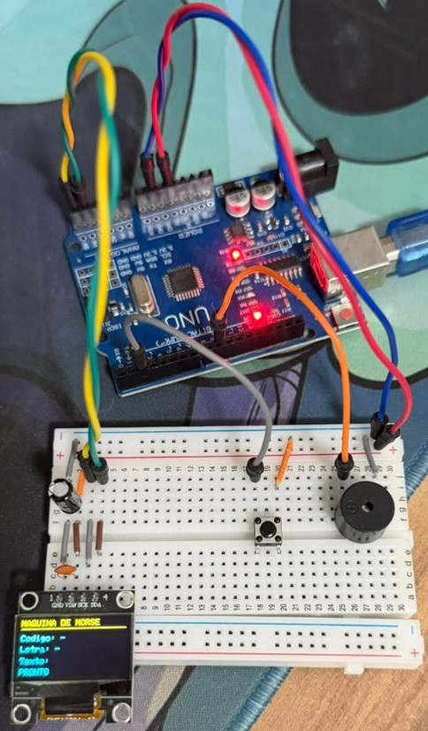

<div align="center">

# 📡 Máquina de Morse

**Transmissor e decodificador de código Morse com Arduino Uno, botão, buzzer e display OLED**

[](https://www.arduino.cc/)
[](https://isocpp.org/)

</div>

---

## 📋 Descrição

A **Máquina de Morse** detecta quanto tempo o botão permanece pressionado e converte o pulso em ponto ou traço. Pausas separam letras e palavras. Uma árvore binária em C++ decodifica a sequência, enquanto o buzzer reproduz cada pulso e o display OLED apresenta o código recebido e o texto.

O projeto explora temporização, debounce de entrada, decodificação de árvore binária e integração de periféricos I2C.

---

## ⚙️ Componentes Utilizados

| Quantidade | Componente | Especificação |
|:---:|---|---|
| 1x | Arduino Uno | ATmega328P |
| 1x | Botão momentâneo | Entrada com pull-up interno |
| 1x | Buzzer piezo passivo | Acionado com tone() |
| 1x | Display OLED | SSD1306 I2C, 128×64 |
| — | Jumpers e protoboard | — |

> O firmware requer buzzer passivo para controlar a frequência. Verifique a tensão de alimentação aceita pelo seu módulo OLED.

---

## 🔌 Pinagem

```
Arduino Uno
├── D2  → Botão → GND (INPUT_PULLUP)
├── D9  → Buzzer passivo → GND
├── A4  → OLED SDA
└── A5  → OLED SCL
```

O botão lê HIGH em repouso e LOW quando pressionado. A alimentação do OLED deve seguir a especificação do módulo.

---

## 🖼️ Esquemático e montagem

### Esquemático elétrico

<!-- Adicione a imagem exportada do LTspice em circuit_images/esquematico.png -->


O arquivo [maquina-de-morse.asc](Esquem%C3%A1tico/maquina-de-morse.asc) mostra as interconexões do Arduino Uno, botão normalmente aberto, buzzer piezo passivo e OLED SSD1306 I2C. Os rótulos de rede associam os periféricos aos pinos usados pelo firmware. Arduino e OLED são módulos externos, não modelos SPICE simulados.

### Montagem real

<!-- Adicione uma foto da montagem em circuit_images/montagem_real.jpg -->


Coloque as imagens nos caminhos indicados acima para que sejam exibidas aqui no GitHub. Até a montagem e captura das fotos, estes espaços ficam reservados para a documentação visual.

---

## 💻 Como Funciona

### Captura e temporização

O botão usa INPUT_PULLUP e debounce por software. Ao soltar, a duração do pulso é comparada com UNIT_MS: até duas unidades é ponto; acima disso é traço. O padrão inicial de uma unidade é 180 ms e pode ser ajustado no sketch após testes com o operador.

### Decodificação

A sequência de pontos e traços percorre uma árvore binária: ponto segue pelo ramo esquerdo e traço pelo direito. A tabela inclui A–Z e 0–9. Após uma pausa de três unidades, o firmware fecha a letra; após sete unidades sem novo pulso, insere um espaço.

### Retorno ao operador

O buzzer toca enquanto o botão está pressionado, sem bloquear a leitura do próximo pulso. A OLED SSD1306 mostra a sequência atual, a letra decodificada e o texto acumulado (últimos 32 caracteres). Segurar o botão por 2 s ou mais limpa o texto.

---

## 🗂️ Estrutura dos Arquivos

```
maquina-de-morse/
├── README.md
├── post_linkedin.txt
├── circuit_images/                  # Imagens do projeto (vazia inicialmente)
├── Esquemático/
│   └── maquina-de-morse.asc         # Esquemático de interconexões LTspice
└── sketch_maquina-de-morse/
    └── sketch_maquina-de-morse.ino  # Firmware principal
```

---

## 🚀 Como Usar

1. Instale a Arduino IDE e as bibliotecas Adafruit GFX Library e Adafruit SSD1306.
2. Monte as ligações indicadas, confirmando a tensão do seu OLED.
3. Abra sketch_maquina-de-morse/sketch_maquina-de-morse.ino.
4. Selecione Arduino Uno e a porta serial correta.
5. Carregue o sketch. Pressione e solte o botão para transmitir; uma pausa fecha a letra.

---

## 🔧 Personalização

Ajuste UNIT_MS no início do sketch para calibrar a duração do ponto (e CLEAR_MS para o tempo de limpeza). O limiar atual é duas unidades, e o bip dura o tempo em que o botão fica pressionado. A montagem e os tempos precisam ser validados no hardware real.

---

## ✅ Estado e Próximos Passos

- [x] Criar estrutura inicial do projeto e firmware base.
- [x] Desenhar o esquemático de interconexões no formato LTspice.
- [ ] Testar botão, buzzer e OLED no Arduino Uno.
- [ ] Calibrar a temporização e validar letras, números e espaços.
- [ ] Adicionar fotos e demonstração em circuit_images/.

*Desenvolvido por Felipe Grolla*
